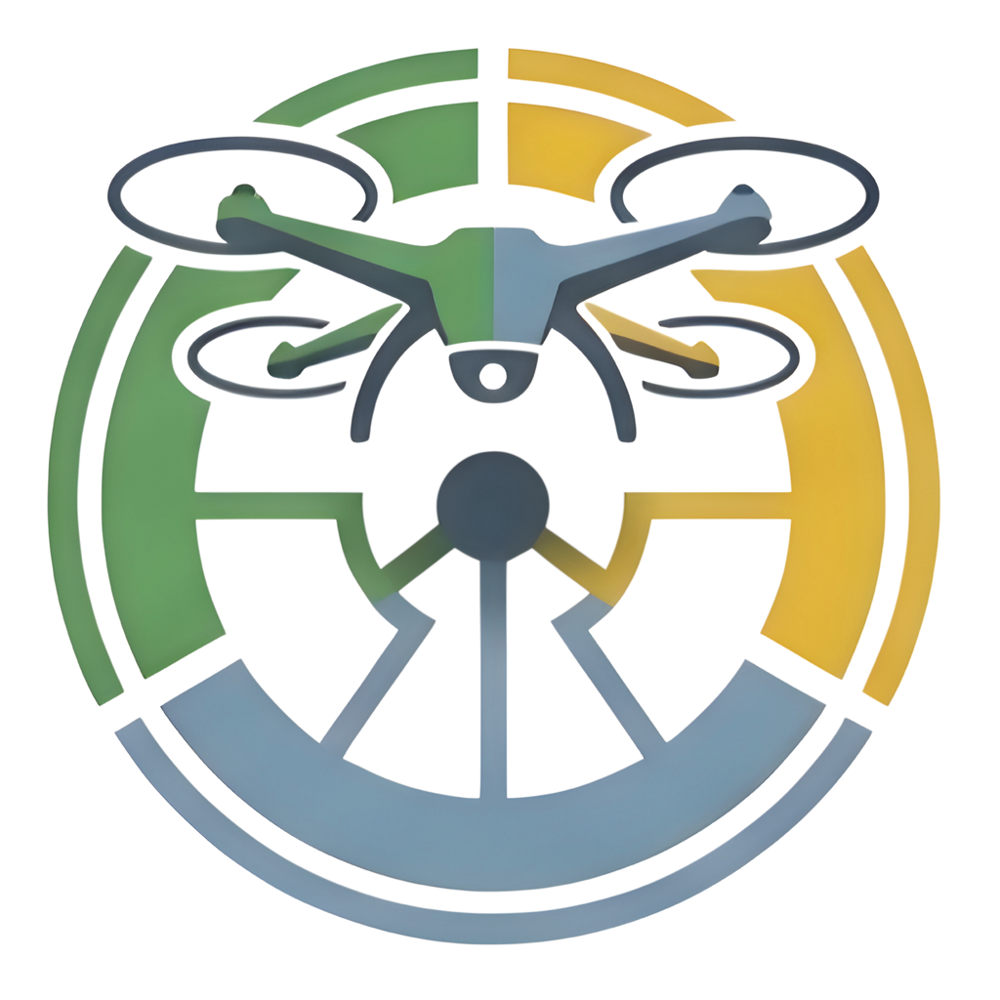

# Dīvi

**Fly. Analyze. Decide.**

*Dīvi (दीवि), from Magadhi Prakrit, the mother of Bengali: Dī, the intellect, and Vi, the bird.*
The project was called Avispria. The command is now `divi` (the old `avispria` command still
works), and this repository keeps its old address on GitHub for now.

Dīvi is a free, open-source toolkit for researchers who map with consumer **RGB drones** (no
special sensor needed). It runs on your own computer, works without internet once installed (only the optional map
background and place search use it, and only when you switch them on), and has
four parts:

- **Plan a flight**: describe the area you want to map and get DJI Fly missions, with a prediction of
  the resolution and overlap you will really get over your terrain, hills and trees included.
- **Check your photos**: find out from their metadata whether they overlap enough to make a good map,
  and where the weak spots are, before you spend hours processing them.
- **Make maps**: turn the photos into an orthophoto, a surface model and a point cloud with
  [WebODM](https://webodm.org), on your computer, with a record of exactly what was done.
- **A field page for your phone**: checklists, calculators and a flight log that work with no signal.

> **Status: early version, not yet flight-tested.** Planning and checking are tested against real DJI
> Fly files and public datasets, but no mission made by Dīvi has been flown yet. Start with a small
> test in open, flat terrain ([first test flight guide](docs/field/first-test-flight.md)) and read the
> [disclaimer](DISCLAIMER.md) before using any output near an aircraft. It is built and checked
> for the **DJI Lito X1** (a Mini 4 Pro profile exists but its numbers are not verified); other DJI drones
> can be added from one original photo.

---

## Install and run

You need two free programs. **Git** downloads Dīvi from GitHub. **uv** sets up everything else,
including the right version of Python (3.12), by itself, so you do not need to install Python.
Pick your system:

### Windows 10 or 11

1. Open **PowerShell** (Start menu, type `PowerShell`).
2. Install Git (skip this if `git --version` already works):

       winget install --id Git.Git -e

3. Install uv:

       powershell -ExecutionPolicy ByPass -c "irm https://astral.sh/uv/install.ps1 | iex"

4. **Close PowerShell and open a new one**, so that it finds the new programs.
5. Download Dīvi:

       git clone https://github.com/Mraz11/Divi.git
       cd Divi

6. Set it up (once; it downloads the packages and takes a minute or two):

       uv sync --locked

7. Run it: double-click **`Start-Divi.bat`** in the Dīvi folder, or type `uv run divi ui`.
   Your web browser opens with Dīvi.

### macOS

1. Open **Terminal** (press Cmd+Space, type `Terminal`).
2. Install Git. Type `git --version`: if it is missing, macOS offers to install the developer tools,
   say yes (or use `brew install git` if you use Homebrew).
3. Install uv:

       curl -LsSf https://astral.sh/uv/install.sh | sh

4. **Close Terminal and open a new window**, so that it finds uv.
5. Download Dīvi:

       git clone https://github.com/Mraz11/Divi.git
       cd Divi

6. Set it up (once; takes a minute or two):

       uv sync --locked

7. Run it: type `./start-divi.sh`, or double-click **`Start-Divi.command`** in Finder. (If macOS
   refuses the double-click, use the Terminal command.) Your web browser opens with Dīvi.

### Linux (Debian or Ubuntu; other systems are similar)

1. Open a terminal and install Git and curl (on Fedora use `dnf` instead of `apt`):

       sudo apt update && sudo apt install -y git curl

2. Install uv, then **open a new terminal window**:

       curl -LsSf https://astral.sh/uv/install.sh | sh

3. Download Dīvi and set it up (once; takes a minute or two):

       git clone https://github.com/Mraz11/Divi.git
       cd Divi
       uv sync --locked

4. Run it: `./start-divi.sh`. Your web browser opens with Dīvi. On a computer with no screen
   (a server), use `uv run divi ui --no-browser`. Dīvi only listens on the computer it runs on,
   so forward its port to your own computer with `ssh -L 8080:127.0.0.1:8080 you@server` and open
   **http://127.0.0.1:8080** there.

### Check that it works

    uv run divi version
    uv run divi doctor

`doctor` reports your computer's memory, disk space and whether WebODM is running.

### Update to a newer version later

    git pull
    uv sync --locked

### If something goes wrong

| What you see | What to do |
|---|---|
| `uv` or `git` "is not recognized" / "command not found" | Close the terminal and open a new one; the install only takes effect in new windows. |
| The browser did not open | Open **http://127.0.0.1:8080** yourself. The terminal shows the exact address (it uses the next free port if 8080 is taken). |
| First start is slow | Normal: the packages are downloaded once. |
| Nothing happens when double-clicking | Run `uv run divi ui` from a terminal in the Dīvi folder to see the message. |

### WebODM, needed only for "Make maps"

Planning flights and checking photos work without it. To make maps, install **WebODM** from
[webodm.org/download](https://webodm.org/download) and start it before using "Make maps".

- **Windows:** use the WebODM for Windows installer. Dīvi finds its processing engine by itself.
  This is the setup Dīvi has been tested with.
- **macOS and Linux:** the processing engine usually runs in Docker. The simplest way is to run just
  the engine, which is all Dīvi needs:

      docker run -d -p 127.0.0.1:3000:3000 opendronemap/nodeodm

  Dīvi looks for it at `http://localhost:3000`. If yours is somewhere else, type its address
  under *Make maps, Advanced*, or add `--url http://host:port` on the command line. This route has not
  been tested by the project yet; please report what you find (Apple Silicon Macs may need an engine
  image built for ARM: see the OpenDroneMap documentation).

---

## Using Dīvi

### The window interface (no terminal needed)

Dīvi is one pipeline of eight engines, and a project goes through them in order:

    Plan -> Mission -> Photo check -> Reconstruct -> Map -> Analyse -> Export -> Report

The top bar shows the engines and marks the ones that are done. Every screen says "Step n of 8",
where its engine stands, and has **Back** and **Next** buttons, at the top and at the bottom. The Start
page says the one thing to do next and lists your projects. See [the workflow](docs/field/workflow.md).

A **project** is one flight campaign with a folder of its own. Give it a name on the Start page and it
stays in the list, so you can switch between projects and continue one on another computer. The folder
holds a small record (`divi_project.json`) of where the missions, photos and maps are; it never holds
coordinates.

Start it as described above. It has a Start screen, a screen for each engine (Mission has two), and a
light/dark switch in the top corner:

| Screen | What it does |
|---|---|
| **Start** | Shows what your computer can do and whether WebODM is running. |
| **1. Plan a flight** | First choose what to capture: a flat map, a 3D model of an area, or a 3D model of one object. Then describe the area (by numbers, a map file, or by **drawing it on a map**: polygon, rectangle, circle or line, with parts left out and bands around shapes; find the place by name or use your location, see [the map guide](docs/map.md)), your drone and what you need; get DJI Fly mission files, the route on a map, and the prediction of what you will really get. |
| **2. Send to DJI Fly** | Sends a plan straight into DJI Fly on your Android phone (USB cable or Wi-Fi), with the original kept, and copies a mission from the phone to use as your sample. See [the phone guide](docs/field/phone-bridge.md). |
| **2. Fly** | A checklist for before you go, at the site and after landing. Nothing to do on the computer. |
| **3. Check my photos** | A verdict, the key numbers, a map of where each photo was taken, and every warning explained in plain words ("what it means" and "what to do"). Optionally uses an elevation model so results are right over hills. |
| **4. Make maps** | Pick the photos and a quality level; Dīvi checks that your computer can handle the job, follows the progress (you can cancel), and gives you the orthophoto, surface model and point cloud. |
| **5. Cut the maps** | Cuts maps that are already made to your study area (KML, KMZ, shapefile, GeoJSON), with a buffer if you want; the uncut maps are kept and the cut can be undone. Optional. |
| **6. Measure** | Measures canopy height, trees, cover and biomass from maps that are already made: again after a cut, or with a better ground model or trees measured on the ground. The photos are not stitched again. A **What to measure** panel (also on Make maps) switches each analysis on or off: land cover, buildings, roads, street shade, 3-30-300 checks, relative heat exposure, biomass, colour indices, symptom flags. The canopy height model with its quality checks and the tree crowns are always made. Command line: `divi analyse ... --off landcover --off roads`. **Relative heat exposure** ranks where daytime heating is likely (sun hours from the surface model's shadows, 09:00 to 16:00 on the flight day; albedo from brightness, fixed for green vegetation; cooling by vegetation), with each part as its own band and the sky view factor; it is not temperature, since an RGB camera cannot measure heat, so check it against a thermal camera before reporting it. |
| **7. Export** | Saves the maps and measurements for QGIS and other programs in `export/` inside the maps folder: red, green and blue as separate GeoTIFFs, the full-colour orthophoto, the surface, ground and canopy height models, the ground uncertainty, land cover and one GeoTIFF per colour index (all Cloud-Optimised GeoTIFFs with a band name, unit and QGIS style beside them), and a GeoPackage of editable layers (tree tops with heights and biomass, crowns, buildings, roads) that opens styled in QGIS. A README and a manifest say what each file is. A Xylo Forest option will follow when that app's format is settled. |
| **7. Map images** | Makes map images for papers and posters from any layer (orthophoto, canopy height, surface and ground models, land cover, any colour index): width as a journal column (85, 120, 170 mm), a page or custom, height fitted to the map or set; 150 to 1200 dpi; PNG, TIFF, PDF or SVG (vector text, editable); title, caption, legend or colour bar, north arrow, scale bar, coordinate grid, tree crown outlines, colours and range. A preview shows the exact layout before saving to `export/figures/`. |
| **8. Report** | Makes one report of the project (`divi_report.html`, opens in any browser without the internet; print it to PDF): the results with their 95% ranges, pictures of the maps, the methods written from what was done, the quality warnings, how the maps were made, where the files are, the limits to state, and how to cite Dīvi. |

Everything stays on your computer, except two optional things that use the internet only when you use
them: the map background and the place search in the map (see [the map guide](docs/map.md)). The
interface listens on `127.0.0.1` only, so nothing is reachable from the network.

To plan a flight you need **your own DJI Fly sample mission** (a two-point waypoint mission saved in DJI
Fly and copied to the computer): Dīvi copies the exact file format your DJI Fly uses from it. The
*Plan a flight* screen explains how to get it.

### The field page for your phone

Open **https://mraz11.github.io/Divi/** on your phone. Then, on Android (Chrome), use the menu and
choose *Install app*; on iPhone (Safari), use Share, then *Add to Home Screen*. After the first visit it
works with no signal. It has pre-flight, in-air and after-landing checklists, calculators that follow the
planner (resolution, spacing, speed, survey time, what trees do to a plan made for flat ground), and a
flight log that records the takeoff coordinates Dīvi asks for. Everything stays on the phone.

### The command line

The same features are available as commands. `uv run divi --help` lists them, and
`uv run divi <command> --help` shows every option.

| Command | What it does |
|---|---|
| `plan` | Plan a survey and write DJI Fly mission files, an RC spot-check sheet and a report. |
| `qa` | Check overlap, coverage, blur, gimbal angle, altitude and timing of survey photos. |
| `process` | Check, upload and process a photo folder with WebODM; download the results with a provenance record. |
| `analyse` | Land cover, trees, buildings, rooftop greenery, roads, street trees and green numbers from the results of `process`, for a forest, farm or town (done automatically after processing). See [the analysis guide](docs/field/analysis.md). |
| `canopy` | Canopy height model (surface minus ground), canopy cover, gaps and tree tops from the results of `process` (done automatically after processing). See [the canopy guide](docs/field/canopy.md). |
| `doctor` | Check this computer, and whether it can process a given photo folder. |
| `engine` | Find WebODM's processing engine and show what it supports. |
| `ui` | Open the window interface. |
| `maps` | Open Dīvi Maps: only the after-flight part (make maps from photos, continue a stopped job). `Start-Divi-Maps.bat` (Windows) and `start-divi-maps.sh` / `Start-Divi-Maps.command` (Linux, macOS) start it with a double-click. |
| `resume` | Continue a processing job that stopped half way (Stop pressed, window closed, computer off), from its results folder: what is done is not done again. |
| `compare-flights` | Change of a colour index between two flights of the same place, by each place's rank within its own flight (colours from a drone's JPEGs are not comparable directly). |
| `clip` | Cut the stitched maps (orthophoto, surface and ground models) to an area from a KML, KMZ, shapefile, zip or GeoJSON, with an optional buffer; `--undo` puts the uncut maps back. `process --clip` does it right after stitching. |
| `advise` | How to fly for what you want to measure (crowns, heights, cover, plants, crown symptoms, leaf lesions, buildings): ground resolution, overlap and height, or why it cannot be done from a mapping flight. |
| `drones` | List the known aircraft and camera modes. |
| `camera-from-photo` | Print a camera profile derived from one original photo. |
| `scan` | Rings of photos around one tree, building or other object, for a 3D model: heights, camera tilts and photos worked out so the whole surface is covered. See [the object scan guide](docs/field/object-scan.md). The kinds of scan (flat map, 3D of an area, 3D of an object): [scan types](docs/field/scan-types.md). |
| `phone` | Talk to DJI Fly on an Android phone from the computer: `status`, `slots`, `send`, `pull`, `pair`, `connect`. |
| `inspect`, `lint`, `sheet`, `prepare-copy` | Look inside, check, summarise and install a DJI Fly mission file. |

Examples (on Windows write paths with backslashes):

    uv run divi plan area.geojson --template my_dummy.kmz --takeoff 12.3456,98.7654 \
        --gsd-cm 2 --dem dem.tif --out out/survey
    uv run divi qa photos/ --recursive
    uv run divi doctor photos/
    uv run divi process photos/ --out results/ --preset standard
    uv run divi resume results/
    uv run divi pipeline
    uv run divi status results/
    uv run divi export results/
    uv run divi report results/
    uv run divi cite
    uv run divi advise crowns --size 3
    uv run divi clip results/results study_area.kml --buffer 10
    uv run divi analyse results/results --field-heights trees.csv --reference glo30.tif
    uv run divi canopy results/results

Photos from a drone other than DJI usually record only a height above sea level, not the height above
the ground. On a flat site tell `qa` where the ground is (`--ground-elev 463.7`, in metres above sea
level); on a site with hills use `--dem` instead. The window interface has the same field.

Planning over trees on flat ground: add `--flat --surface-height 25` (the canopy height in metres), so
the treetops, not the ground, get the height you asked for.

---

## Develop

    uv run pre-commit install
    uv run python scripts/check.py       # formatting, lint, types, tests; the same checks as CI

Continuous integration runs the same checks on Linux, Windows and macOS. [HANDOFF.md](HANDOFF.md) is the
developer's guide to the design and the decisions made so far. Two things are generated and must be
refreshed after changes: run `python scripts/field_page.py` after changing the phone page or
`src/avispria/data/drones.toml`, and `python scripts/make_branding.py` after changing the logo (the
tests fail if they are out of date).

The colours, light and dark, come from one place, `src/avispria/app/ui/theme.py`, which both the window
interface and the phone page use; a test measures the contrast of every pairing. See
[branding/README.md](branding/README.md) about the logo.

## Licence and citation

Dīvi is free software under the **AGPL-3.0-or-later** ([LICENSE](LICENSE)): anyone may use,
change and share it, and must share the source of what they pass on. Those who cannot meet that
condition (closed products, hosted services) need the **commercial licence**, which is free of
charge for organisations in Bangladesh and in low-income countries and paid or by collaboration
for others: see [COMMERCIAL.md](COMMERCIAL.md).

If you publish results made with Dīvi, please cite it: [CITATION.cff](CITATION.cff), or
`divi cite`. The licence of the logo is still to be decided
([branding/README.md](branding/README.md)). Developer rules: [docs/LICENSING.md](docs/LICENSING.md).
